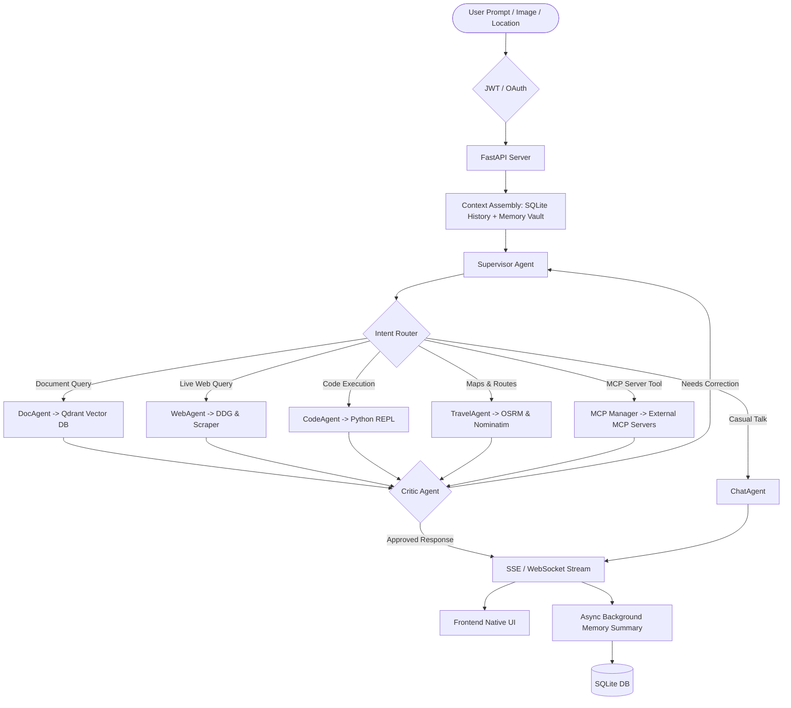

# 🤖 Ｋ Ⓞ Ɖ 𐌡 – Enterprise Multi-Agent AI with Vision, RAG, MCP & Rich UI

A production-grade, full-stack AI Assistant (K O D A) built using **FastAPI**, **LangChain**, and **LangGraph**. It features a swappable dual-LLM engine supporting **Google Gemini 2.5 Flash**, custom **Remote GPU Models (Qwen / Mistral)**, and **OpenAI**.

This project implements a robust multi-agent supervisor architecture, native Model Context Protocol (MCP) integration, an animated native frontend with Branching Memory, Multimodal Vision, multi-tenant authentication, secure local document RAG, real-time web scraping, background email automation, and rich interactive UI cards.

> **Architecture Overview:** KODA orchestrates specialized worker workflows (Document, Web Search, Code Execution, Travel Routing, Chat) using a central Supervisor agent. The system features native **MCP (Model Context Protocol)** support, allowing dynamic discovery and connection to external MCP servers via Stdio transport. It is provider-agnostic and enforces strict tenant isolation for vector search and conversation memory.

---

## ✨ Key Features

### 🧠 Multi-Agent Supervisor Architecture
A dynamic router evaluates user intent and passes execution to specialized sub-agents:
* **DocAgent:** Leverages local RAG over Qdrant to extract highly precise data from private PDFs, TXT files, and workspace documents.
* **WebAgent:** Deep-scrapes the web (DuckDuckGo + BeautifulSoup) for real-time news, current events, and live product searches.
* **CodeAgent:** Executes Python code in a sandboxed REPL environment for calculations and logic testing.
* **TravelAgent:** Calculates actual driving routes and ETAs (OSRM + Nominatim) and renders interactive map cards.
* **ChatAgent:** Direct, lightweight conversational responses for small talk and standard queries.
* **CriticAgent (Reflection Loop):** Autonomously reviews tool execution results. If initial searches return incomplete data, the Critic formulates a revised search plan and triggers a second execution loop before generating the final response.

### ⚡ Native LangGraph StateGraph Engine
* **Explicit StateGraph Workflow:** Implemented using pure `langgraph.graph.StateGraph` in `backend/agents/langgraph_supervisor.py`.
* **State & Edge Construction:** Typed State (`SupervisorState`), Nodes (`intent_router`, `rag_retrieval`, `planner`, `tool_execution`, `critic_reflection`, `synthesis`), and Conditional Edges (`add_conditional_edges`) compiled via `workflow.compile()`.
* **Token Streaming:** Supports full graph streaming using `langgraph_agent.astream()` over Server-Sent Events (SSE) and WebSockets.

### 🔌 Model Context Protocol (MCP) Integration
* **Dynamic Tool Discovery:** Connects to external MCP servers (e.g., Filesystem, SQLite, Fetch) via Stdio transport.
* **Auto-Wrapping:** Automatically wraps MCP server tools into LangChain `BaseTool` instances and registers them with the Supervisor's tool registry.
* **Configurable Setup:** Easily add new MCP servers via `mcp_servers.json`.

### 👁️ Multimodal Vision & Document Processing
* **Native Vision Integration:** Drag-and-drop or paste images directly into the chat. The backend processes the image locally and passes visual tokens to the multimodal LLM for detailed analysis.

### 📄 Secure Multi-Tenant RAG (Retrieval-Augmented Generation)
* **100% Offline Embeddings:** Uses local HuggingFace Embeddings (`all-MiniLM-L6-v2`), keeping private document contents entirely local.
* **Qdrant Vector DB:** Local vector search isolated per user ID to guarantee strict data privacy.
* **SHA-256 Deduplication:** Hashes file uploads to prevent duplicate processing, saving CPU cycles and vector index space.
* **Async Ingestion:** Background tasks handle chunking and embedding so the UI stays responsive.

### 📧 Integrated Email Service & Automation Suite
* **Email Router & Webhooks:** Full handling of inbound/outbound emails, webhooks, and settings.
* **Background Polling & Sync:** Background workers poll and monitor email mailboxes with rule enforcement and notification dispatch.
* **OAuth & Security:** Secure token storage, crypto utilities, and role-based permissions for email handling.

### 💾 Advanced Dynamic Memory Manager
* **Long-Term Vault (Topic Summarization):** Asynchronous background AI categorizes and condenses past chat turns into structured summaries in SQLite, enabling long-range context retention.
* **Sliding Window:** Smart character budgeting (max 12,000 chars) anchors initial system prompts while dynamically truncating middle turns to accommodate large tool payloads.

### 🎨 World-Class Frontend UI
* **Branching Memory:** Edit past messages to create parallel conversation branches and switch between them seamlessly.
* **Rich Interactive UI Cards:** Directly renders HTML/CSS components in chat (Uber-style interactive maps, location cards, e-commerce product links, gold calculators).
* **SSE & WebSocket Streaming:** Supports both Server-Sent Events (SSE) and full-duplex WebSockets for token-by-token streaming with live Markdown, MathJax, and code syntax highlighting.
* **Voice & Dictation Mode:** Real-time audio wave visualizer, Speech-to-Text dictation, and Text-to-Speech read-aloud supporting multiple languages and accents.
* **Export & Sharing:** Export chats to PDF, Word (DOCX), or TXT, or generate secure public share URLs.
* **Temporary (Incognito) Mode:** One-click toggle to disable all database and LocalStorage persistence.

### 🔐 Security & Infrastructure
* **Multi-Method Auth:** JWT authentication with optional Google OAuth 2.0 and Email-based registration.
* **Rate Limiting:** SlowAPI protection to prevent endpoint abuse.
* **Live GPS Context:** Optional browser geolocation injection provides real-time geographic context to the LLM.
* **Automated Cleanup & Backups:** Scheduled background tasks manage 24-hour full zip backups and garbage collection for soft-deleted chats and orphaned Qdrant vectors.

---

## 🏗️ Architecture & Processing Flow



---

## 📂 Project Structure

```text
chatbot_agents/
├── .env                       # Environment Variables & API Keys
├── main.py                    # FastAPI Server Entrypoint
├── mcp_servers.json           # MCP Server Configurations
├── requirements.txt           # Python Project Dependencies
├── chat_history.db            # SQLite Database
├── chat_database.db           # SQLite Database
│
├── backend/
│   ├── test_api.py            # API Testing Suite
│   ├── view_qdrant.py         # Qdrant Vector Inspection Utility
│   ├── project_flow           # Project Flow Documentation
│   │
│   ├── agents/                # Agent Orchestration
│   │   ├── intent_router.py   # Intent Classification & Routing Rules
│   │   ├── supervisor.py      # Main Supervisor Agent & Reflection Loop
│   │   └── langgraph_supervisor.py # Explicit LangGraph StateGraph Engine
│   │
│   ├── config/                # Backend Configuration Package
│   │   └── config.py          # Central App Config
│   │
│   ├── core/                  # Core App Lifecycle & Middleware
│   │   ├── config.py          # Core Config Settings
│   │   ├── lifespan.py        # FastAPI Lifespan Handler
│   │   ├── middleware.py      # Middlewares Setup
│   │   ├── security.py        # Security & CORS Setup
│   │   ├── shutdown.py        # Subprocess & Worker Cleanup
│   │   ├── startup.py         # Initialization & Health Checks
│   │   └── static.py          # Static Assets & Template Mounts
│   │
│   ├── database/              # SQLite Database Layer
│   │   ├── chat_database.py   # Database Queries & Session Management
│   │   └── chat_database.db
│   │
│   ├── email_service/         # Email Engine & Automation
│   │   ├── crypto.py          # Email Encryption Helpers
│   │   ├── dashboard.py       # Email Analytics & Metrics
│   │   ├── history.py         # Email Transaction Logs
│   │   ├── mock.py            # Mock Email Provider
│   │   ├── oauth.py           # Email Provider Auth
│   │   ├── parser.py          # MIME & Email Parsing
│   │   ├── permissions.py     # Email Authorization Guards
│   │   ├── polling.py         # Mailbox Polling Loop
│   │   ├── processor.py       # Email Rule Execution Engine
│   │   ├── watch.py           # Mailbox Event Watcher
│   │   └── worker.py          # Background Email Worker
│   │
│   ├── integrations/
│   │   └── mcp/               # Model Context Protocol (MCP) Client
│   │       ├── client.py      # Stdio MCP Client Transport
│   │       ├── connection.py  # Process Connection Management
│   │       ├── converter.py   # LangChain Tool Conversion
│   │       ├── exceptions.py  # Custom MCP Error Types
│   │       ├── manager.py     # MCP Server Manager & Lifecycle
│   │       ├── registry.py    # MCP Tool Registry & Router Injection
│   │       ├── schemas.py     # MCP Data Transfer Schemas
│   │       ├── simple_server.py # Built-in Mock MCP Server
│   │       ├── test_mcp.py    # MCP Integration Tests
│   │       ├── test_mcp_connection.py # Connection Unit Test
│   │       └── README.md      # MCP System Reference
│   │
│   ├── loaders/               # Ingestion Layer
│   │   └── document_loader.py # Document Loading & Vector Chunking
│   │
│   ├── memory/                # Context & Memory Vault
│   │   ├── conversation_memory.py # Dynamic Sliding Window & Summaries
│   │   └── vector_memory.py   # Fast Vector Cache
│   │
│   ├── prompts/               # Prompt Engineering
│   │   ├── agent_prompts.py   # Sub-agent Prompts
│   │   └── system_prompts.py  # Master System & Supervisor Prompts
│   │
│   ├── providers/             # LLM Model Providers
│   │   ├── base_provider.py   # Abstract Base Provider
│   │   ├── gemini_provider.py # Google Gemini API Provider
│   │   └── llm_provider.py    # Custom Remote GPU / OpenAI Provider
│   │
│   ├── routers/               # FastAPI Endpoint Routers
│   │   ├── auth.py            # JWT Auth Routes
│   │   ├── chat.py            # Streaming Chat API
│   │   ├── config.py          # Dynamic Config API
│   │   ├── email_auth.py      # Email Auth Routers
│   │   ├── email_dashboard.py # Email Metrics Endpoints
│   │   ├── email_notifications.py # Email Notification Settings
│   │   ├── email_settings.py  # User Email Config API
│   │   ├── email_webhook.py   # Incoming Webhook Listeners
│   │   ├── history.py         # Chat Session History APIs
│   │   ├── share.py           # Chat Export & Public Share Links
│   │   ├── sync.py            # Workspace Synchronization APIs
│   │   ├── translate.py       # Message Translation Service
│   │   ├── upload.py          # Document & Image Ingestion API
│   │   ├── web.py             # Scraping & Web Endpoint
│   │   ├── websocket.py       # Full-Duplex WebSocket Endpoint
│   │   └── workspace.py       # Workspace File Management
│   │
│   ├── tools/                 # Agent Tool Definitions
│   │   ├── calculator_tools.py# Python REPL Sandboxed Execution
│   │   ├── image_tools.py     # Maps, Routes & Vision Utilities
│   │   ├── rag_tools.py       # Qdrant Vector Retrieval Tools
│   │   └── web_tools.py       # DuckDuckGo Search & Web Scraper
│   │
│   ├── utils/                 # General Utilities
│   │   ├── helpers.py         # Helper Functions
│   │   └── sync.py            # Async Helper Utilities
│   │
│   ├── websocket/             # WebSocket Management
│   │   └── manager.py         # Connection Pool & Stream Dispatcher
│   │
│   ├── workers/               # Background Services
│   │   ├── backup.py          # 24-hr Zip Database Backups
│   │   └── cleanup.py         # Soft-delete & Garbage Collector
│   │
│   └── workflows/             # Execution Flow Controllers
│       ├── rag_workflow.py    # RAG Pipeline Flow
│       └── web_workflow.py    # Web Scraping Flow
│
├── frontend/                  # User Interface
│   ├── templates/             # HTML Templates
│   │   ├── index.html         # Main Single-Page Chat Web Application
│   │   ├── login.html         # Auth & Registration Page
│   │   └── gold_calculator.html # Gold Calculator UI Card Template
│   │
│   ├── css/                   # Stylesheets & Modules
│   │   ├── animations.css     # UI Transitions & Dynamic Animations
│   │   ├── base.css           # CSS Reset & Design Tokens
│   │   ├── chat.css           # Chat Bubbles & Card Formatting
│   │   ├── input.css          # Input Controls & Dictation Bar
│   │   ├── login.css          # Login & Signup Page Styling
│   │   ├── main.css           # Global Main Layout Rules
│   │   ├── mobile.css         # Responsive Breakpoints & Mobile Views
│   │   ├── panels.css         # Settings & Side Panels
│   │   ├── sidebar.css        # Navigation & History Sidebar
│   │   └── theme.css          # Theme Customizations
│   │
│   └── js/                    # JavaScript Modules
│       ├── core_logic.js      # Streaming Engine & Network Dispatch
│       │
│       ├── auth/              # Client Authentication
│       │   └── login.js       # JWT & OAuth Login Handlers
│       │
│       ├── chat/              # Chat Logic & Renderers
│       │   ├── attachments.js # File & Image Upload Management
│       │   ├── branching.js   # Conversation Branching Engine
│       │   ├── chat_renderer.js # Message Formatting & Streaming DOM Updates
│       │   ├── chat_sessions.js # Session Switcher & Branch Navigation
│       │   ├── export_chat.js # Chat Export (PDF, DOCX, TXT)
│       │   ├── markdown_mermaid.js # Markdown, MathJax & Mermaid Renderer
│       │   ├── message_sender.js # Prompt Processing & Submissions
│       │   └── shared_chat.js # Public Shared Chat Viewer
│       │
│       ├── core/              # App Foundation
│       │   ├── app_init.js    # Application Main Initializer
│       │   ├── bootstrap.js   # Script Dependency Loader
│       │   ├── config.js      # Client Endpoint Configs
│       │   ├── state.js       # Global Reactive State Manager
│       │   └── sync.js        # Offline Storage & Server Sync
│       │
│       ├── settings/          # Application Settings & Integrations
│       │   ├── account.js     # User Profile & Security Settings
│       │   ├── clear_all_chats.js # Purge History Handlers
│       │   ├── custom_ai.js   # Custom GPU & Engine Selector Settings
│       │   ├── email_intelligence.js # Email Automation UI Dashboard
│       │   └── theme.js       # UI Theme Toggle Logic
│       │
│       └── ui/                # UI Interactivity & Components
│           ├── dictation_visualizer.js # Real-time Voice Audio Visualizer
│           ├── dropdown_dismiss.js # Global Dropdown Dismiss Handlers
│           ├── icons.js        # SVG Icon Library
│           ├── input_controls.js # Textarea Auto-expand & Controls
│           ├── sidebar.js     # Sidebar Controls & Collapsible State
│           ├── sources_panel.js # RAG Document Citations Panel
│           ├── styles_inject.js # Dynamic CSS Injector
│           ├── toolbar.js     # Action Toolbars
│           └── workspace.js   # Workspace File Explorer Drawer
│
├── qdrant_db/                 # Local Qdrant Vector DB Storage
├── local_ai_models/           # Local HuggingFace Embeddings Cache
├── uploads/                   # Document & Image Upload Directory
└── backups/                   # Automated Daily Database Backups
```

---

## 🚀 Setup and Installation

### 1. Prerequisites
* Python 3.9 or higher
* Node.js / `npx` (optional, for running JavaScript-based MCP servers)
* API Key for Google Gemini, OpenAI, or a custom LLM endpoint

### 2. Environment Configuration
Create a `.env` file in the root directory:

```env
# General & Security
SECRET_KEY="your-random-jwt-secret-key"
PORT=8000

# Google OAuth (Optional)
GOOGLE_CLIENT_ID="your_google_oauth_client_id"

# ENGINE 1: Google Gemini 2.5 Flash
GEMINI_API_KEY="your_gemini_api_key_here"

# ENGINE 2: Custom Remote GPU / OpenAI (Optional)
MISTRAL_API_BASE="http://your_custom_endpoint_ip/v1"
MISTRAL_API_KEY="your_api_key_here"
MISTRAL_MODEL_NAME="Qwen/Qwen3.6-27B-FP8"
```

### 3. Install Dependencies
Activate your virtual environment and install the required dependencies:

```bash
pip install -r requirements.txt
```

### 4. Running the Server
Launch the FastAPI server entrypoint:

```bash
python main.py
```
Or run directly via Uvicorn:
```bash
uvicorn main:app --host 127.0.0.1 --port 8000 --reload
```

Open your browser and navigate to: `http://127.0.0.1:8000`

---

## 🔌 Configuring Model Context Protocol (MCP)

To connect external tools via MCP, update `mcp_servers.json` in the root directory:

```json
{
  "mcpServers": {
    "mock_server": {
      "command": "python",
      "args": ["backend/integrations/mcp/simple_server.py"]
    },
    "filesystem": {
      "command": "npx",
      "args": [
        "-y",
        "@modelcontextprotocol/server-filesystem",
        "uploads"
      ]
    }
  }
}
```

KODA automatically detects configured servers on boot, establishes Stdio connections, retrieves tool specifications, and registers them into the Supervisor's execution flow.

---

## 🔍 Diagnostics & Testing Utilities

* **Inspect Vector Database:** Verify document chunks stored in Qdrant:
  ```bash
  python backend/view_qdrant.py
  ```
* **Test MCP Integration:** Test Stdio MCP server discovery and execution:
  ```bash
  python backend/integrations/mcp/test_mcp.py
  ```

---

## 📝 Terminal Logs & Diagnostics
During operation, KODA provides real-time execution logs in the terminal:
* `📂 [SQLite DB] Successfully loaded X previous messages...`
* `🔌 [MCP Manager] Successfully initialized server 'mock_server' with X tools.`
* `🛠️ [Agent Thought] Decided to use tool: document_search_tool`
* `🔍 [Qdrant DB] Searching vector DB for relevant chunks...`
* `✅ [Qdrant DB] Successfully retrieved X chunks.`
* `💾 [SQLite DB] Saved assistant response to chat history.`

